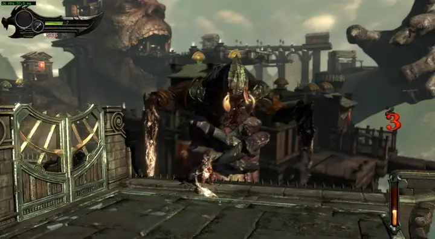

# GoWA-pc

A static recompilation of God of War: Ascension (PS3, BCES01741) for PC.

The game's PPU code is translated to C++ and compiled for x86-64. SPU programs are compiled ahead of time as well, and some of the heavier SPU jobs (Edge geometry, cloth, parts of the job system) have been rewritten by hand and checked against the original output. The PS3 system libraries the game uses are reimplemented in the runtime, and the RSX command stream is drawn with Vulkan.

<p align="center">
  
  <br>
  <a href="media/demo.mp4">Watch the full recording (2:53)</a>
</p>

The recording was made on Linux with an i7-8700K and an RTX 4070 at 1080p internal resolution. The counter in the corner is the game's frame rate.

This is a hobby project. It is not affiliated with Sony Interactive Entertainment or Santa Monica Studio, and it contains no game code or data. You need your own copy of the game.

## Status

The game boots, plays the intro, and is playable from a save through the early levels. It is not finished and not every part of the game has been tested.

On an i7-8700K with an RTX 4070, calm areas run at around 55-60 fps. Large fights run at roughly 35-45 fps and can still drop lower for short moments. Most of the remaining cost is SPU work (mainly Edge geometry jobs), not the GPU.

Known issues:

- Frame drops in heavy fights and short hitches when new areas stream in.
- Audio can crackle in busy scenes.
- Linux is the main development platform at the moment. The Windows build has not been tested since the Linux port.

## Requirements

- A dump of your own disc (BCES01741) and the 01.12 update.
- PS3 firmware 4.91 and the keys needed to decrypt the game and the firmware modules. These are not included.
- Python 3 with pycryptodome for the setup tools.
- Linux: clang, CMake, Ninja, SDL3, a Vulkan driver, and optionally FFmpeg (libavcodec) for the videos.
- Windows: Visual Studio 2022 Build Tools with clang-cl, CMake and Ninja.

## Setup

The setup is still a set of manual steps. The tools in `tools/` extract and decrypt the disc, the update and the firmware. After that, `tools/setup.py` generates all game-derived sources into `out/` from your own files:

```
python3 tools/setup.py --steps all
```

By default it expects the decrypted 01.12 executable at `bin/01.12/` and the decrypted firmware modules at `fw/4.91/`. Nothing in `bin/`, `fw/`, `keys/` or `out/` is tracked by git.

## Building

Linux:

```
cmake -S . -B build-linux -G Ninja -DCMAKE_C_COMPILER=clang -DCMAKE_CXX_COMPILER=clang++
cmake --build build-linux
```

Windows:

```
build.cmd
```

## Running

Start `God of War Ascension` from the build folder. A small launcher opens first, where you set the game folder, the update folder and a few options. The settings are kept in `user/settings.ini` next to the executable. Most options can also be set with `GOWA_*` environment variables.

## License

MIT, see `LICENSE`. It covers the code in this repository only, not the game. Third-party components keep their own licenses, see `THIRD_PARTY_NOTICES.txt`. God of War is a trademark of Sony Interactive Entertainment.
